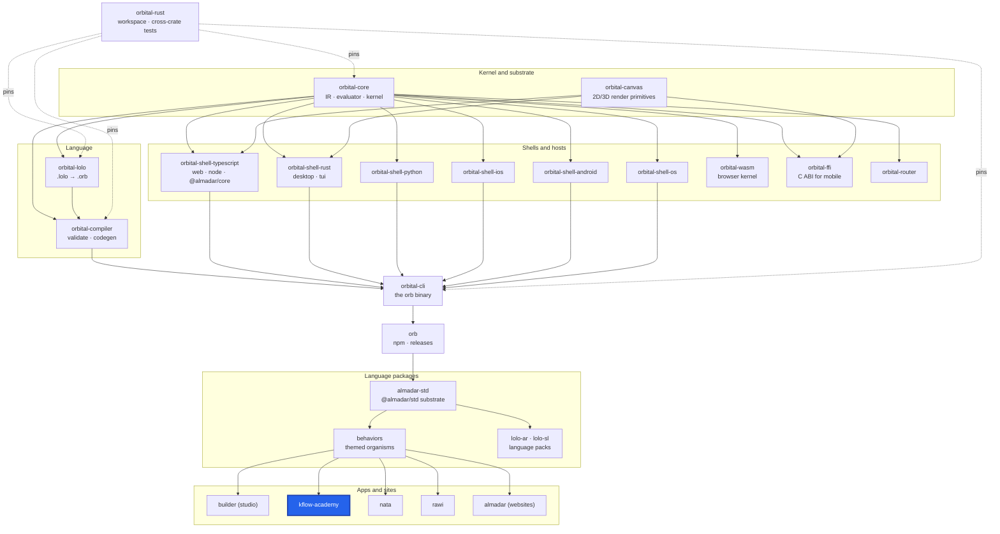

<div align="center">

# KFlow Assets

**Static asset pack, served from a CDN.**

[](https://github.com/almadar-io/almadar-kflow-assets/actions/workflows/deploy.yml)

</div>

Static assets for the KFlow knowledge platform: story illustrations, audio and media files, plus shared board packs under `shared/`. The files are served from https://almadar-kflow-assets.web.app, deployed to Firebase Hosting by CI.

## Where this fits

KFlow Assets is the asset pack for the KFlow product, so [kflow-academy](https://github.com/almadar-io/almadar-kflow-academy) (`apps/kflow`) is highlighted.



| Upstream (this repo depends on) | Downstream (depends on this repo) |
|---|---|
| [none](https://github.com/almadar-io/almadar-kflow-assets): a data-only repo | [kflow-academy](https://github.com/almadar-io/almadar-kflow-academy): the KFlow app |

## Quick start

```bash
git clone git@github.com:almadar-io/almadar-kflow-assets.git
cd almadar-kflow-assets
git lfs pull        # large files stay pointer stubs without this
```

Images, audio, video and models are tracked with Git LFS. The CDN root is the repo root: a file at `shared/<board>/<file>` is served at `https://almadar-kflow-assets.web.app/shared/<board>/<file>`.

## What's inside

```
stories/                                      # story illustration assets
shared/                                       # asset packs per UI board (arena, battle, boardgame, ...)
brand/ characters.json manifest.json asset-workflow.json
firebase.json                                 # Hosting target kflow-assets, cache and CORS headers
```

## Development

There is no build and no test suite; the repo is data. Keep the manifests consistent with the files present. `deploy.yml` runs on push to `main` when an image, audio, video, model, PDF, `manifest.json` or `firebase.json` file changes (and on manual dispatch): it pulls the LFS objects, checks that they are real files, and deploys Hosting target `kflow-assets` of project `kflow-b3a39`. Open gaps are in `Almadar_Gaps.md`. Work on `main` only. Manual deploy: `firebase deploy --only hosting:kflow-assets`.

## Docs

- [Orb documentation](https://orb.almadar.io/docs): the language, the `orb` CLI and how the pieces fit

## License
No license file in this repo.
